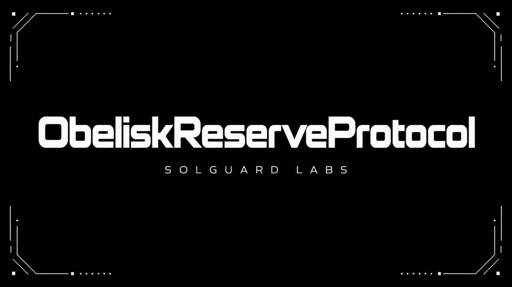
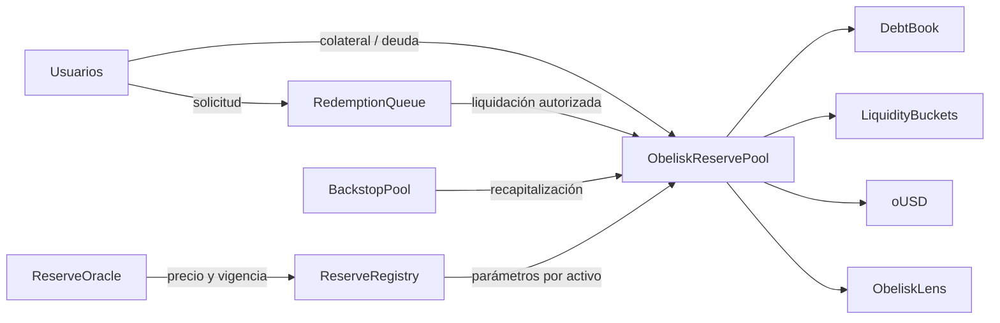

# Obelisk Reserve Protocol



Obelisk Reserve Protocol implementa una stablecoin sobrecolateralizada, `oUSD`, con posiciones por activo, reservas distribuidas en buckets, redenciones diferidas y un fondo de respaldo. El código Solidity incluye controles de precio, límites de emisión, roles segregados y vistas de seguimiento. Esta entrega identifica una versión del repositorio; no acredita que los contratos estén desplegados en una red pública.

## Arquitectura



Una posición deposita colateral admitido y acuña hasta el LTV configurado. El registro controla precio, cap de depósito, cap de emisión, ratio de liquidación y pesos de buckets. El pool usa el libro de deuda para saldos de posición y `LiquidityBuckets` para el orden de consumo de reservas. La cola asigna un ticket a cada solicitud de salida, con plazo mínimo de espera y vencimiento. El backstop es una fuente separada de recapitalización, sujeta a permisos y liquidez disponible.

Las bibliotecas y el contrato `ReserveStressEngine` permiten calcular escenarios de cartera sin alterar estado. Son herramientas de lectura para seguimiento operativo, no sustituyen los controles transaccionales del pool.

## Modelo económico

Para un activo con `d` decimales y precio en WAD, `valor = (cantidad normalizada a 18 decimales × precio) / 10¹⁸`. La deuda máxima de una posición es `valor_colateral × LTV_bps / 10 000`. La emisión también comprueba el cap del activo y el objetivo de cobertura de reservas. Las salidas se cotizan al precio del registro, restan la comisión configurada y consumen buckets según el orden operativo.

Ejemplo nominal: con 1 000 000 de rUSDC a precio 1 y LTV de 75 %, una posición puede acuñar hasta 750 000 `oUSD` antes de comisiones, siempre que el resto de controles permita la operación. Un objetivo de reserva de 12 500 bps exige al menos 1,25 unidades de valor de reserva por unidad de supply utilizada en la comprobación. El ejemplo no supone que un feed externo sea infalible ni modela costes de ejecución.

`ReserveStressEngine.assess` admite valores por activo y recortes en bps. Para valores 600 000/400 000, recortes 10 %/25 %, supply 600 000 y objetivo 15 000 bps, devuelve NAV estresado 840 000, ratio 14 000 bps y déficit hipotético 60 000 frente al objetivo. Es un escenario suministrado por el operador, no una valoración automática de mercado.

Consulta [modelo económico](docs/modelo-economico.md) para unidades, redondeos y límites del cálculo.

## Requisitos y validación

- Foundry 1.7 o superior y Solidity 0.8.28.
- Bash para los scripts reproducibles. `scripts/bootstrap.sh` obtiene `forge-std` en la versión fijada si falta.
- No se requiere un RPC externo para compilar y probar.

```bash
bash scripts/tests.sh
bash scripts/ci.sh
```

El CI comprueba formato, compila y ejecuta la suite Forge. El script de despliegue de `script/` sirve para entornos controlados; los tests crean contratos efímeros en la EVM local. Utiliza claves de prueba para los ejemplos locales.

## Documentación

- [Arquitectura y límites de confianza](docs/arquitectura.md)
- [Modelo económico y escenarios](docs/modelo-economico.md)
- [Integración local](docs/integracion.md)
- [Operación y conciliación](docs/operacion.md)
- [Modelo de seguridad](docs/seguridad.md)
- [Política de seguridad](SECURITY.md)
- [Historial de cambios](CHANGELOG.md)

## Estructura y release

```text
src/core/        pool, posiciones, registro, comisiones y contabilidad
src/modules/     cola de redenciones
src/pools/       buckets y backstop
src/oracle/      precios y guardas
src/lens/        vistas agregadas
src/analytics/   escenarios puros de estrés
tests/          pruebas de integración y analítica
scripts/        bootstrap, tests y CI
docs/           contratos operativos en español
```

Una publicación estable usa PR con CI verde, rama `production`, tag anotado `v1.0.0` y release `Production 1.0.0` sobre el mismo commit. El workflow de integridad comprueba esa convergencia. La palabra «Production» nombra el artefacto de código, no un despliegue on-chain.
