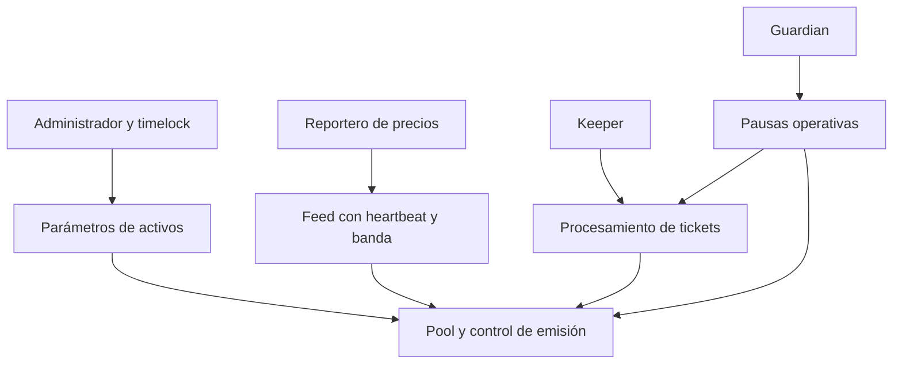

# Política de seguridad

## Alcance y confianza

El alcance revisable incluye `src/`, las pruebas Forge, el script de despliegue y la configuración de CI. `ReserveOracle` y el registro determinan qué activos y precios se aceptan; el pool custodia colateral y coordina deuda, buckets y `oUSD`. La cola y el backstop tienen permisos separados. La seguridad operativa depende además de la custodia de claves, la calidad de feeds y el comportamiento real de los ERC-20 integrados, que no pueden probarse solo con esta suite local.

## Propiedades esperadas

- Las posiciones nuevas y ampliadas respetan LTV, deuda mínima y caps por activo.
- Los precios de las operaciones deben estar habilitados, vigentes y dentro de límites configurados.
- Un ticket solo se ejecuta tras el delay y antes del vencimiento; no se liquida dos veces.
- Las transferencias de salida consumen buckets registrados y revierten ante liquidez insuficiente.
- Solo los roles autorizados alteran parámetros, asignaciones, pausas o rutas de settlement.
- Los cálculos de estrés son puros: no autorizan emisión ni bloquean redenciones.

La documentación de [arquitectura](docs/arquitectura.md) identifica las fronteras entre los módulos. Los contratos auxiliares de gobernanza y lectura no sustituyen los permisos del pool. Un integrador debe comprobar roles, direcciones y configuración efectiva del despliegue que esté revisando.

## Validación

`bash scripts/ci.sh` verifica formato, build y pruebas en Foundry. La suite cubre posiciones, mint/burn, lifecycle de tickets, buckets, backstop y escenarios de estrés. GitHub Actions ejecuta el mismo script en push y PR; Dependabot vigila Actions. El tag y el release disponen de una comprobación independiente de referencias. Estas verificaciones no constituyen una auditoría externa ni una garantía de ausencia de riesgos.

## Reporte responsable

No publiques una secuencia sensible en una issue. Incluye commit, red o entorno de reproducción, precondiciones, estado inicial, operaciones, resultado observado, impacto económico medible y propuesta de corrección. Utiliza el reporte privado de seguridad de GitHub si está habilitado; de lo contrario, contacta al propietario por un canal privado antes de divulgar detalles. Nunca incluyas claves ni datos de terceros.
