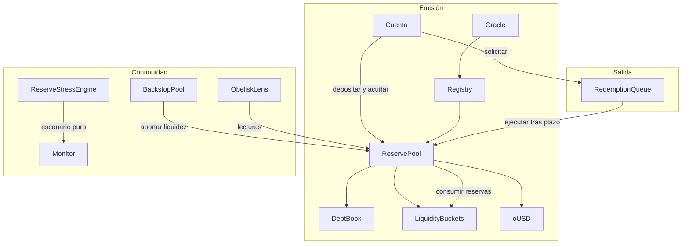

# Arquitectura y límites de confianza

## Flujos principales

`ObeliskReservePool` coordina la entrada de colateral, la emisión de `oUSD`, los cambios de deuda y la entrega de reservas. `DebtBook` mantiene la propiedad y las magnitudes de cada posición; `LiquidityBuckets` registra la distribución operativa por activo. `ReserveRegistry` combina parámetros de admisión y precio del oráculo. `RedemptionQueue` mantiene tickets con estado y llama a la interfaz de settlement del pool. `BackstopPool` aporta reservas solo mediante la ruta autorizada de recapitalización.

## Autoridad de datos

El pool obtiene el supply de `oUSD` del token, balances de reserva del contrato de buckets y deuda de `DebtBook`. `ObeliskLens` agrega vistas, pero no sustituye esos contratos como fuente de verdad. El motor de estrés no consulta contratos: acepta valores y recortes suministrados por quien lo llama. Esta separación evita atribuir carácter vinculante a una simulación.

## Activos y unidades

Cada activo registra `decimals`, identificador de oráculo, límites y pesos de cuatro buckets. `ReserveMath` convierte unidades a WAD antes de calcular valor; `rUSDC` en tests usa 6 decimales. `oUSD` usa 18. Una integración debe comprobar la coherencia entre `decimals` configurados y el token real, además del comportamiento de `transfer`/`transferFrom`.
