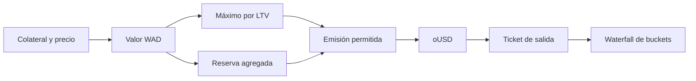

# Modelo económico y escenarios

## Posición de reserva

Sea `C` la cantidad del activo, `d` sus decimales y `P` el precio WAD. El valor de colateral es `floor(C × 10^(18−d) × P / 10¹⁸)` para `d ≤ 18`; la biblioteca gestiona también `d > 18`. Con `LTV_bps`, la deuda máxima es `floor(valor × LTV_bps / 10 000)`. La posición conserva deuda y colateral por separado del balance físico de los buckets. La emisión comprueba además la cobertura de reservas que define el pool, los caps y la pausa.

Una redención toma un importe `oUSD`, aplica `redemptionFeeBps`, convierte valor neto al activo seleccionado y consume liquidez en el orden `immediate → deferred → strategic → backstop`. `minOut` protege la cantidad recibida. El estado del ticket tiene solicitud, primer instante ejecutable y deadline; cancelación y expiración siguen rutas distintas de la ejecución.

## Cálculo de escenarios

`ReserveStressEngine.assess` toma valores ya normalizados `vᵢ`, recortes `hᵢ` en bps, supply y objetivo de reserva. Calcula `valor_estresado = Σ floor(vᵢ × (10 000−hᵢ) / 10 000)`, `ratio_estresado = floor(valor_estresado × 10 000 / supply)` y `déficit_objetivo = max(0, floor(supply × objetivo / 10 000)−valor_estresado)`. Si supply es cero, el ratio devuelto es `uint256.max`; el valor requerido y déficit son cero. La concentración es `Σ floor(pesoᵢ² / 10 000)` con `pesoᵢ = floor(vᵢ × 10 000 / Σv)`.

| Activo | Valor inicial | Recorte | Valor estresado |
| --- | ---: | ---: | ---: |
| Reserva A | 600 000 | 10 % | 540 000 |
| Reserva B | 400 000 | 25 % | 300 000 |
| Total | 1 000 000 | — | 840 000 |

Para supply 600 000 y objetivo 15 000 bps, el valor requerido es 900 000; el escenario muestra déficit 60 000 y ratio 14 000 bps. La concentración inicial vale 5 200 bps. Estos números no incluyen profundidad de mercado, slippage, correlaciones ni evolución temporal del precio.

`quoteWaterfall` devuelve el consumo indicativo por los cuatro buckets y cualquier saldo no cubierto. Una cotización no reserva liquidez: el resultado final depende del estado on-chain al ejecutar.
