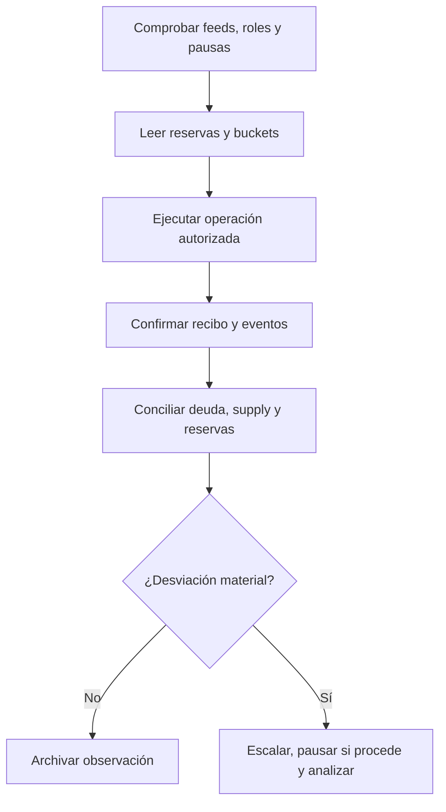

# Operación y conciliación

## Rutina de observación

Antes de abrir actividad, revisa roles vigentes, pausas, heartbeat de feeds, caps, parámetros de emisión, balances físicos y distribución de buckets. Las operaciones de keeper requieren comprobar ticket, instante ejecutable, deadline y liquidez del activo de salida. Tras cada lote, concilia eventos de cola y pool con balances de token y estado de buckets; registra hash de transacción y versión del cliente empleado.



`ParameterTimelock` ofrece una superficie de gobierno diferido; `KeeperRouter` coordina llamadas operativas permitidas. Una instalación debe documentar qué contrato ostenta cada rol y quién conserva la clave de emergencia. Ni las vistas ni `ReserveStressEngine` activan pausas por sí solos.

## Comprobaciones de entrega

```bash
bash scripts/tests.sh
bash scripts/ci.sh
```

Valida el mismo commit en local y GitHub Actions. Para un artefacto estable, `main`, `production` y `v1.0.0^{}` deben resolver al mismo SHA, y el release debe llamarse `Production 1.0.0`. Esta secuencia publica código; cualquier despliegue de contratos requiere una revisión operativa independiente.
